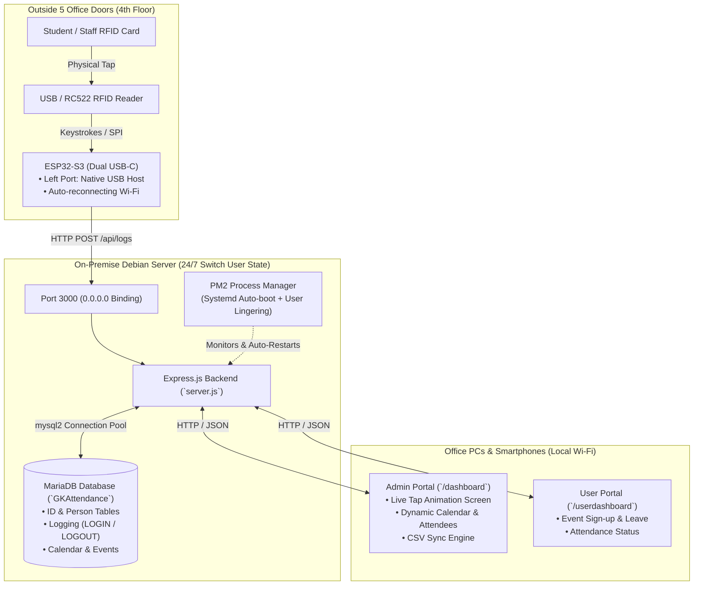

# GKAttendance — Complete System Master Manual & Deployment Guide

> **Version:** 2.0 (Testing Branch)  
> **Target OS:** Debian 11/12 (Server) & Windows 10/11 (Development/Client)  
> **Hardware:** ESP32-S3-N16R8 (Dual USB-C) + USB HID / RC522 RFID Scanners  
> **Database:** MariaDB Server 10.x / 11.x  
> **Runtime:** Node.js v18/20 LTS + PM2 Process Manager  

---

## Table of Contents
1. [System Architecture](#1-system-architecture)
2. [Debian Server 24/7 Configuration](#2-debian-server-247-configuration)
3. [MariaDB Database Setup & Schema](#3-mariadb-database-setup--schema)
4. [Backend Application Setup & PM2](#4-backend-application-setup--pm2)
5. [ESP32-S3 Hardware & Firmware](#5-esp32-s3-hardware--firmware)
6. [User Accounts, CSV Sync & Card Registration](#6-user-accounts-csv-sync--card-registration)
7. [Web Dashboards & Calendar System](#7-web-dashboards--calendar-system)
8. [Master Troubleshooting Playbook](#8-master-troubleshooting-playbook)
9. [Maintenance & Daily Operations](#9-maintenance--daily-operations)

---

## 1. System Architecture



---

## 2. Debian Server 24/7 Configuration

The Debian server stays in the **"Switch User"** or lock screen state. The following operating-system level rules guarantee continuous background uptime.

### 2.1 Prevent System Sleep & Suspend
Desktop environments (like GNOME) automatically suspend after 15–20 minutes of idle time. Mask system sleep targets:

```bash
sudo systemctl mask sleep.target suspend.target hibernate.target hybrid-sleep.target
```

### 2.2 Enable User Process Lingering
By default, Debian terminates background services owned by a user when their desktop session closes or switches. Enable lingering so PM2 processes run 24/7:

```bash
sudo loginctl enable-linger $USER
```

### 2.3 Allow Port 3000 Through Firewall
Ensure other office devices and ESP32 microcontrollers on the local network can communicate with the server:

```bash
sudo ufw allow 3000/tcp
```
*(If UFW is not installed, verify that `iptables` or `nftables` does not reject inbound TCP port 3000).*

### 2.4 Verify Server IP Address
Check your local network IP:
```bash
hostname -I
```
*(Example: `10.50.180.12`. We recommend setting a DHCP reservation or Static IP on your office router).*

---

## 3. MariaDB Database Setup & Schema

### 3.1 Install and Start MariaDB
```bash
sudo apt update
sudo apt install -y mariadb-server
sudo systemctl enable --now mariadb
```

### 3.2 Initialize Users and Privileges
Open the database console:
```bash
sudo mariadb
```
Run the following SQL commands:
```sql
CREATE DATABASE IF NOT EXISTS GKAttendance;

-- Create application users
CREATE USER IF NOT EXISTS 'GKAttendance_LowPriority'@'localhost' IDENTIFIED BY 'n0root4u!';
CREATE USER IF NOT EXISTS 'GKAttendance_SuperAdmin'@'localhost' IDENTIFIED BY 'f4llr00taccess!';

-- Grant required permissions
GRANT ALL PRIVILEGES ON GKAttendance.* TO 'GKAttendance_SuperAdmin'@'localhost';
GRANT ALL PRIVILEGES ON GKAttendance.* TO 'GKAttendance_LowPriority'@'localhost';
FLUSH PRIVILEGES;
EXIT;
```

### 3.3 Import Database Schemas
Navigate to the `Schema` directory and run:
```bash
cd ~/Documents/GKAttendance/Schema

# 1. Main schema (Tables, Foreign Keys, initial data)
sudo mariadb < GKAttendance.sql

# 2. Dynamic Calendar & Event Attendee schema
sudo mariadb < events_migration.sql
```

### 3.4 Ensure Seed Data (Labs & Roles)
If `GKLab` or `Role` tables are not populated, run:
```bash
sudo mariadb -e "
USE GKAttendance;

INSERT IGNORE INTO GKLab (lab_id, lab_code, lab_name) VALUES
(1, 'CeLT', 'Center for Language Technologies'),
(2, 'CeHCI', 'Center for Human-Computer Innovations'),
(3, 'Cite4D', 'Center for ICT for Development'),
(4, 'CAR', 'Center for Automation Research'),
(5, 'CNIS', 'Center for Networking and Information Security'),
(6, 'CIVI', 'Computational Imaging and Visual Innovations'),
(7, 'GAME Lab', 'Graphics, Animation, Multimedia and Entertainment Laboratory'),
(8, 'HXIL', 'Human-X Interactions'),
(9, 'TE3D', 'Technology, Education, Entertainment, Empathy, Design House'),
(10, 'Bioinformatics Lab', 'Bioinformatics Lab');

INSERT IGNORE INTO Role (role_id, role_name) VALUES
(1, 'Student'),
(2, 'Staff'),
(3, 'Researcher'),
(4, 'Professor'),
(5, 'Visitor');
"
```

Verify tables:
```bash
sudo mariadb -e "USE GKAttendance; SHOW TABLES;"
```

---

## 4. Backend Application Setup & PM2

### 4.1 Install Node.js LTS and PM2
```bash
curl -fsSL https://deb.nodesource.com/setup_20.x | sudo -E bash -
sudo apt install -y nodejs
sudo npm install -g pm2
```

### 4.2 Configure `.env`
Place the `.env` file in the root project folder (`~/Documents/GKAttendance/.env`):

```env
PORT=3000
DB_HOST=localhost
DB_USERNAME=GKAttendance_LowPriority
DB_PASSWORD=n0root4u!
DB_DATABASE=GKAttendance
EMAIL_USER=your_office_email@gmail.com
EMAIL_PASS=your_google_app_password
```

### 4.3 Install Dependencies
```bash
cd ~/Documents/GKAttendance/backend
npm install
```

### 4.4 Start Server with PM2 & Enable Auto-Boot
```bash
# Start the server daemon
pm2 start server.js --name "gk-attendance"

# Generate systemd startup script
pm2 startup
```
*(Copy and execute the exact `sudo env PATH=...` command printed on the screen).*

Save the process state:
```bash
pm2 save
```

Verify status and live logs:
```bash
pm2 status
pm2 logs gk-attendance --lines 20 --nostream
```

---

## 5. ESP32-S3 Hardware & Firmware

### 5.1 Dual USB-C Port Specification (ESP32-S3-N16R8)
The ESP32-S3-N16R8 board has two USB-C ports:
- **Right Port (UART / Programming):** Connected to CH340 serial bridge chip. Plug this into your computer for flashing and Serial Monitor. When deployed at the door, plug into a standard 5V wall charger.
- **Left Port (Native USB OTG Host):** Connected directly to GPIO 19 (`D-`) and GPIO 20 (`D+`). Connect your **USB RFID Scanner** here via a USB-A to USB-C adapter.

> [!WARNING]
> Dev boards do not backfeed 5V across USB ports due to protective diodes. Ensure the RFID scanner's LED lights up. If unpowered, use an OTG Y-splitter cable with 5V power injection or wire 5V from the header `5V` pin.

### 5.2 Arduino IDE Flash Settings
Under the **Tools** menu in Arduino IDE:

| Setting | Required Value |
|---|---|
| **Board** | `ESP32S3 Dev Module` |
| **USB CDC On Boot** | **`Disabled`** (Prevents conflict with USB Host) |
| **PSRAM** | **`OPI PSRAM`** (Required for N16R8 chip) |
| **Flash Size** | **`16MB (128Mb)`** |
| **Flash Mode** | **`QIO 80MHz`** |
| **Upload Mode** | `UART0 / Hardware CDC` |
| **USB Mode** | `Hardware CDC and JTAG` |

### 5.3 Production ESP32-S3 Firmware
Install the **`EspUsbHost`** library by *TANAKA Masayuki* via Arduino Library Manager, then upload this sketch:

```cpp
#include <WiFi.h>
#include <HTTPClient.h>
#include "EspUsbHost.h"

// ================= USER CONFIGURATION =================
const char* WIFI_SSID     = "YOUR_OFFICE_WIFI";
const char* WIFI_PASSWORD = "YOUR_WIFI_PASSWORD";

// Replace with your Debian Server IP:
const char* SERVER_URL    = "http://10.50.180.12:3000/api/logs";

#define LED_PIN 2 // Status LED
// ======================================================

EspUsbHost usb;
String scannedCard = "";

void sendCardToServer(String cardUid) {
  if (WiFi.status() != WL_CONNECTED) {
    Serial.println("[Wi-Fi] Not connected. Reconnecting...");
    WiFi.reconnect();
    return;
  }

  HTTPClient http;
  http.begin(SERVER_URL);
  http.addHeader("Content-Type", "application/json");

  String requestBody = "{\"unique_id\":\"" + cardUid + "\"}";

  Serial.println("[HTTP] Sending tap: " + requestBody);
  digitalWrite(LED_PIN, HIGH);

  int httpCode = http.POST(requestBody);

  if (httpCode > 0) {
    String response = http.getString();
    Serial.printf("[HTTP] Server Response (%d): %s\n", httpCode, response.c_str());
  } else {
    Serial.printf("[HTTP ERROR] Failed to reach server: %s\n", http.errorToString(httpCode).c_str());
  }

  http.end();
  digitalWrite(LED_PIN, LOW);
}

void setup() {
  Serial.begin(115200);
  pinMode(LED_PIN, OUTPUT);
  digitalWrite(LED_PIN, LOW);

  WiFi.begin(WIFI_SSID, WIFI_PASSWORD);
  Serial.print("Connecting to Wi-Fi");
  while (WiFi.status() != WL_CONNECTED) {
    delay(500);
    Serial.print(".");
  }
  Serial.println("\n[Wi-Fi Connected!] ESP32 IP: " + WiFi.localIP().toString());

  // Setup USB Host keyboard wedge reader
  usb.onKeyboard([](const EspUsbHostKeyboardEvent &event) {
    if (event.pressed) {
      if (event.ascii == '\r' || event.ascii == '\n' || event.keycode == 0x28) {
        if (scannedCard.length() > 0) {
          Serial.println("\n[CARD TAPPED]: " + scannedCard);
          sendCardToServer(scannedCard);
          scannedCard = "";
        }
      } else if (event.ascii >= ' ' && event.ascii <= '~') {
        scannedCard += (char)event.ascii;
      }
    }
  });

  if (!usb.begin()) {
    Serial.printf("USB Host Init Failed: %s\n", usb.lastErrorName());
  } else {
    Serial.println("System Ready! Tap RFID card to test.");
  }
}

void loop() {
  if (WiFi.status() != WL_CONNECTED) {
    WiFi.reconnect();
    delay(5000);
  }
  delay(10);
}
```

---

## 6. User Accounts, CSV Sync & Card Registration

### 6.1 Default Passwords from `users.csv`
- When accounts are synced from `users.csv`:
  - **Default Password:** The person's **DLSU ID Number** (e.g. `12208127`).
  - **First Login:** Flagged with `must_change_password = 1`. The web portal prompts the user to change their password immediately upon first login.

### 6.2 Linking Physical RFID Cards to Users
If a user taps an unregistered card, the server rejects it with `404 Unregistered Card`. Link the card UID (from Arduino Serial Monitor or tap) to the user's DLSU ID:

```bash
sudo mariadb -e "
USE GKAttendance;

-- 1. Insert or update card in ID table
INSERT INTO ID (unique_id, dlsu_idnumber) VALUES ('2772005086', 12208127)
ON DUPLICATE KEY UPDATE dlsu_idnumber = 12208127;

-- 2. Link card UID to the person
UPDATE Person SET unique_id = '2772005086' WHERE dlsu_idnumber = 12208127;
"
```

---

## 7. Web Dashboards & Calendar System

### 7.1 Access URLs
- **Admin Dashboard:** `http://<SERVER_IP>:3000/dashboard`
- **User Dashboard:** `http://<SERVER_IP>:3000/userdashboard`
- **User Login:** `http://<SERVER_IP>:3000/login`

### 7.2 Features
1. **Live Card Tap Screen (`#scanPanel`):**
   - Automatically polls `/api/logs` every 1.5 seconds.
   - When an ESP32 sends a card tap from an office door, the screen lights up **Green (`LOGIN`)** or **Red (`LOGOUT`)**, displays full user information (Name, Role, Lab, DLSU ID), and increments scan counters live.
2. **Dynamic Event Calendar (`#calendarPanel`):**
   - Admins create events with title, location, start/end dates.
   - Displays live attendee badges (`👥 X Attending`).
   - Admin Attendee Modal allows viewing and removing registered participants.
   - User Portal allows users to 1-click **Join** or **Leave** events.

---

## 8. Master Troubleshooting Playbook

| Issue / Symptom | Root Cause | Solution |
|---|---|---|
| `Cannot find module 'express'` | `npm install` was not run after cloning or unzipping. | Run `cd backend && npm install`. |
| `ERROR 1046: No database selected` | Old SQL script had accidental `DROP SCHEMA` line. | Use updated `Schema/GKAttendance.sql` and run `sudo mariadb < GKAttendance.sql`. |
| `Access denied for user 'GKAttendance_LowPriority'` | Typo in grant statement (`public_lowprio`). | Run `sudo mariadb -e "GRANT ALL PRIVILEGES ON GKAttendance.* TO 'GKAttendance_LowPriority'@'localhost'; FLUSH PRIVILEGES;"`. |
| `Cannot add child row: foreign key constraint fails (lab_id)` | `GKLab` table was empty during CSV import. | Insert default seed data into `GKLab` and `Role` (Section 3.4). |
| `[HTTP ERROR] Failed to reach server: connection refused` | Port 3000 blocked by firewall or backend bound to localhost. | Run `sudo ufw allow 3000/tcp` and verify `server.js` binds to `0.0.0.0`. |
| `rst:0x10 (RTCWDT_RTC_RST)` bootloop on ESP32 | `USB CDC On Boot` is Enabled, or PSRAM mismatch. | In Arduino IDE: set `USB CDC On Boot = Disabled`, `PSRAM = OPI PSRAM`. |
| Serial Monitor displays `□□□□□` (garbage characters) | Baud rate mismatch. | Change Serial Monitor dropdown from `9600` to `115200 baud`. |
| `fatal error: ArduinoJson.h: No such file or directory` | Missing Arduino library. | Install `ArduinoJson` via Library Manager or use string concatenation. |

---

## 9. Maintenance & Daily Operations

### Useful PM2 Commands:
```bash
# View running process status
pm2 status

# View live log stream
pm2 logs gk-attendance

# Restart application
pm2 restart gk-attendance

# Install daily log rotation to save disk space
pm2 install pm2-logrotate
```

### Backing Up the Database:
```bash
mysqldump -u root -p GKAttendance > ~/GKAttendance_Backup_$(date +%F).sql
```
